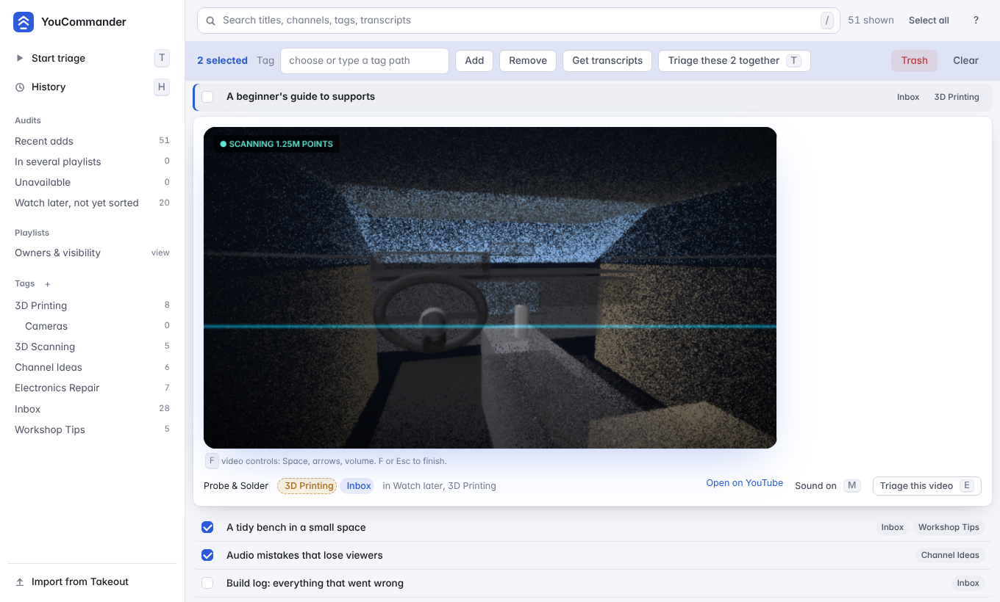
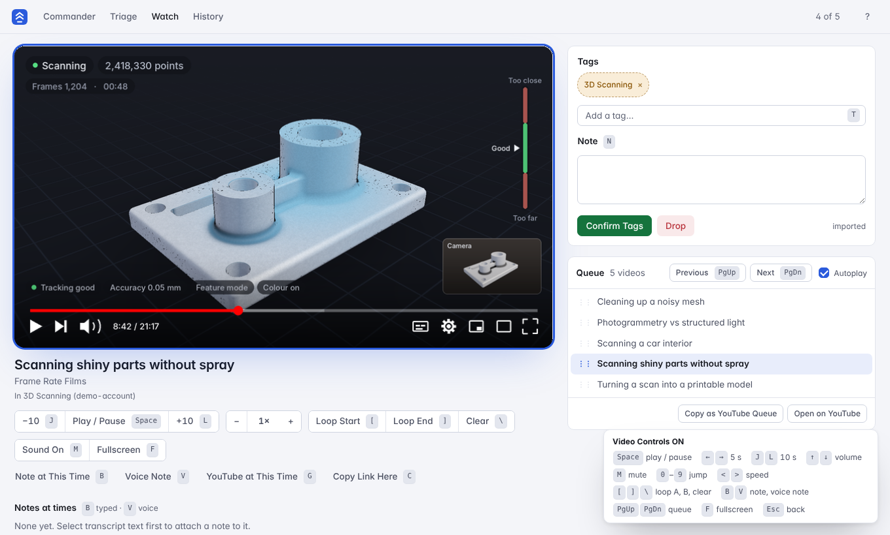

# YouCommander

A private, local-first organizer, watch player and transcript tool for a large YouTube library.

YouCommander imports your playlist exports from Google Takeout into a local SQLite database. From there you can search, tag, triage and watch your videos. **Nothing leaves your machine**: there is no account, no cloud, no telemetry, and it never writes back to YouTube.


*Commander, with a video open in place. The picture in the player is an illustration, since the real player needs YouTube.*


*The Watch page, same illustration caveat.*

## Features

- **Import** the playlist CSVs from a Google Takeout export (a `.zip` or an unpacked folder). Only playlist files are read; watch history, comments and subscriptions are ignored.
- **Commander** – fast keyboard-driven list with full-text search, nested tags (`topic/sub/leaf`), multi-select and bulk tagging.
- **Triage** – step through videos one at a time (or in a batch) to keep, tag, drop or skip, with undo and a change log.
- **Watch page** – local player with resume, speed control, A–B loop, a reorderable queue, previous/next, and a "Copy as YouTube Queue" button.
- **History** – everything you open or watch inside the app, with Continue Watching.
- **Notes** – typed or voice notes at a timestamp, on the current transcript line, or on selected text.
- **Transcripts** – read YouTube captions (via `yt-dlp`) and/or transcribe locally with Whisper, keep both versions, follow along, and search across all transcripts.
- **Voice** (optional) – dictate notes and tags with local `faster-whisper`; optional local Ollama model for tag extraction.

## Quick start

Requires Python 3.10+ (3.12 tested).

**Windows:** double-click `install.bat`, then `start.bat`.

**macOS / Linux:**
```sh
./install.sh
./start.sh
```

Open <http://127.0.0.1:8765>, go to **Import**, and drop in your Takeout file. See [docs/USER_GUIDE.md](docs/USER_GUIDE.md) for how to request the export.

To try it without your own data, run `start_demo.bat` (or `python tools/make_demo.py`, then start with `ORG_DB=demo_data/organizer.db`). The demo library is entirely invented.

## Documentation

| Doc | Contents |
|---|---|
| [User guide](docs/USER_GUIDE.md) | Importing, tagging, triage, watching, notes, transcripts |
| [Keyboard shortcuts](docs/KEYBOARD.md) | Every shortcut per page |
| [Privacy](docs/PRIVACY.md) | What is read, stored and sent |
| [Architecture](docs/ARCHITECTURE.md) | Code layout, schema, test hooks |
| [Troubleshooting](docs/TROUBLESHOOTING.md) | Common problems |
| [Contributing](docs/CONTRIBUTING.md) | Dev setup and tests |
| [Security](docs/SECURITY.md) | Reporting issues |
| [Changelog](docs/CHANGELOG.md) | Release notes |

## Configuration

Environment variables (all optional):

| Variable | Default | Purpose |
|---|---|---|
| `ORG_DB` | `organizer.db` | SQLite database path |
| `ORG_AUDIO_DIR` | `audio_notes` | Where voice-note audio is kept |
| `ORG_IMPORT_DIR` | `imports` | Where uploaded Takeout files are staged |
| `ORG_WHISPER_MODEL` / `ORG_WHISPER_DEVICE` / `ORG_WHISPER_LANG` | `small` / auto / auto | Local Whisper settings |
| `ORG_OLLAMA_URL` / `ORG_OLLAMA_MODEL` | `http://127.0.0.1:11434` / – | Optional local LLM for voice tagging |

The server binds to `127.0.0.1` only. Do not expose it to a network: it has no authentication.

## Caveats

- Playback uses YouTube's embedded player. Some videos disallow embedding and will show a fallback link.
- Fetching captions or audio with `yt-dlp` may be subject to YouTube's Terms of Service. Transcripts are manual and per-video only; you are responsible for how you use them.
- This project is not affiliated with or endorsed by YouTube or Google.

## License

MIT – see [LICENSE](LICENSE).
